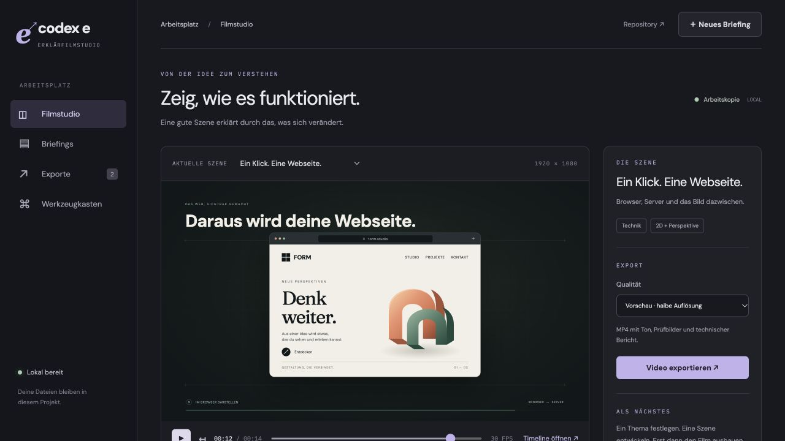

# Codex E · Erklärfilmstudio

Ein lokaler Arbeitsplatz für verständliche Lernvideos: Briefings, abspielbare Szenen, eine Remotion-Timeline, MP4-Exporte und Prüfbilder. Dazu vier eigene Studio-Skills, zwölf installierbare offizielle Remotion-Skills und sechs spezialisierte Codex-Rollen.



## Start

Node.js ab 22.13, Git, FFmpeg und FFprobe verwenden. Auf macOS: `brew install ffmpeg`. System-Chrome wird erkannt; andernfalls verwendet Remotion seine Headless-Shell.

```sh
npm ci
npm run skills:sync
npm run doctor
npm run dev
```

Arbeitsplatz: **http://localhost:3140**. Im Codex-Desktop dieses Repository als Projekt öffnen. Die Skills stehen im nächsten Turn im Projekt zur Verfügung.

Es werden keine API-Schlüssel für das Basissystem benötigt. Die Oberfläche speichert Briefings und rendert implementierte Szenen. Neue Filme werden gemeinsam mit Codex entwickelt; ein Briefing erzeugt nicht von selbst eine Animation.

## Befehle

| Befehl                                           | Ergebnis                                     |
| ------------------------------------------------ | -------------------------------------------- |
| `npm run dev`                                    | Lokales Filmstudio                           |
| `npm run studio`                                 | Remotion-Timeline auf Port 3141              |
| `npm run doctor`                                 | Installierte Werkzeuge und Skills prüfen     |
| `npm run render -- WebsiteSzene`                 | MP4-Vorschau + Kontaktbogen + QA-Bericht     |
| `npm run render -- WebsiteSzene --final`         | Export in voller Auflösung                   |
| `npm run qa -- renders/datei.mp4`                | Vorhandenes Video technisch prüfen           |
| `npm run project:new -- mein-film Mein Film`     | Neues Projektbriefing anlegen                |
| `npm run audio:normalize -- quelle.wav ziel.wav` | Sprache normalisieren                        |
| `npm run check` / `npm test` / `npm run build`   | Konfiguration, Typen, Tests und Build prüfen |

Die Beispiele **WebsiteSzene** (14 s) und **DatenErklaert** (10 s) sind direkt abspielbar. Die Kapitel unter dem Player springen zu den tatsächlichen Stellen im Film.

## Mit Codex produzieren

> Nutze $explainer-director. Erstelle einen 30-sekündigen Erklärfilm darüber, wie eine Webseite funktioniert. Entwickle zuerst eine klare Bildidee und eine überzeugende Szene. Zeige mir eine abspielbare, geprüfte Vorschau.

Die sechs Rollen: `researcher`, `story_designer`, `art_director`, `motion_designer`, `audio_director`, `quality_reviewer`. Sie übernehmen gezielte Aufgaben, wenn Delegation autorisiert ist; Modell und Berechtigungen werden geerbt.

## Struktur

```text
src/app/                 Lokaler Arbeitsplatz mit Vorschau und Briefings
src/remotion/scenes/     Die eigentlichen Filmkomponenten
studio.config.json       Szenen, Formate und Kapitel
projects/                Briefings, Recherche, Storyboards und Abnahme
.agents/skills/          Studio-Skills und lokal installierte Remotion-Skills
.codex/agents/           Sechs projektspezifische Agenten-Rollen
scripts/                 Server, Render, technische QA und Werkzeugprüfung
public/                  Projektassets und lokal vorbereitete offene Schriften
renders/                 Erzeugte Videos, Prüfbilder und QA-Berichte (Git-ignore)
```

[Produktionsablauf](docs/production.md) · [Werkzeuge und optionale Dienste](docs/tools.md) · [Quellen und Lizenzen](THIRD_PARTY.md)

`npm run build` erzeugt die statische Oberfläche. Für Speichern und Export ist der lokale Node-Server mit `npm run dev` nötig; dies ist kein öffentlich gehosteter Dienst.
